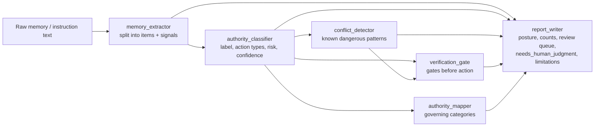
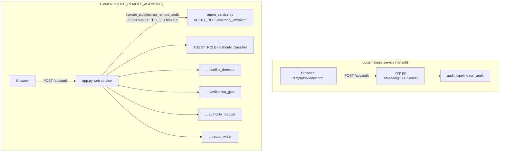
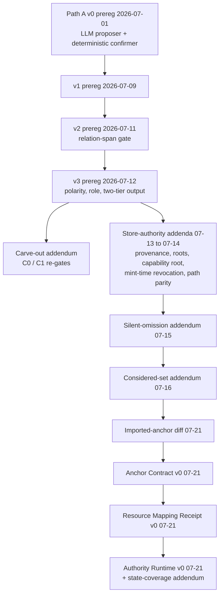
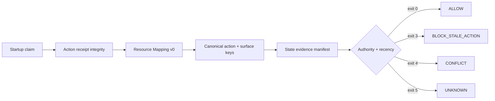

# Architecture

This repository holds two things that share one Python codebase:

1. **The deployed auditor** (`app.py`, `agent_service.py`, `audit_pipeline.py`, six
   deterministic agents). It answers "which old instructions should your AI stop obeying?"
   for a pasted memory or instruction file and renders a report.
2. **The research workbench** (Path A, the v3 store-authority line, and Authority Runtime
   v0). Each step is preregistered in a dated Markdown file, implemented as a deterministic
   gate under `agents/`, exercised against a frozen JSON fixture under `tests/fixtures/`,
   and recorded as JSON + Markdown artifacts under `path_a_eval_artifacts/`.

Everything is Python standard library except `sentry-sdk` (optional tracing, active only
when `SENTRY_DSN` is set). No web framework, database, or queue is used.

## 1. Deployed auditor

### Pipeline

All six stages are deterministic keyword/pattern code in `agents/`. There is no model call
in the deployed pipeline. `audit_pipeline.run_audit` runs them in process; `audit_cli.py`
wraps it for the command line.

| Stage | Module | Output key |
|---|---|---|
| Memory Extractor | `agents/memory_extractor.py` | `items` |
| Authority Classifier | `agents/authority_classifier.py` | `classifications` |
| Conflict Detector | `agents/conflict_detector.py` | `conflicts` |
| Verification Gate | `agents/verification_gate.py` | `verification_gates` |
| Authority Mapper | `agents/authority_mapper.py` | `authority_map` |
| Report Writer | `agents/report_writer.py` | `report` |

### Process topology

* `app.py` serves `templates/index.html` on `GET /`, runs the audit on `POST /api/audit`,
  and also exposes every stage as `POST /agents/<stage>` with the same JSON contract the
  Cloud Run services use (documented in `ADK_ARCHITECTURE.md`).
* `agent_service.py` is one process per role, selected by `AGENT_ROLE`. It accepts a POST on
  any path and serves `GET /health`.
* `remote_pipeline.py` reads one URL per stage from `MEMORY_EXTRACTOR_URL`,
  `AUTHORITY_CLASSIFIER_URL`, `CONFLICT_DETECTOR_URL`, `VERIFICATION_GATE_URL`,
  `AUTHORITY_MAPPER_URL`, and `REPORT_WRITER_URL`.
* The `deploy_*.sh` scripts deploy with `gcloud run deploy --source . --allow-unauthenticated`
  using the `Dockerfile` (Python 3.13 slim).

## 2. Research workbench

### Lineage

Each node is a `*_PREREGISTRATION*` file in the repository root, frozen before the
implementation it governs. Results and release notes are separate dated files
(`*_RESULT_*.md`, `V3_*_RELEASE_NOTE_*.md`, `PATH_A_V3_INDEPENDENT_CHECK_2026-07-14.md`).

### Code map

| Step | Gate module | Runner script | Frozen fixture(s) |
|---|---|---|---|
| Path A proposer + confirmer (v0 to v1) | `agents/semantic_proposer.py`, `agents/semantic_confirmer.py` | `path_a_eval_runner.py` (calls Anthropic or a local Ollama model) | `path_a_authority_change_v0..v2_*.json`, `path_a_dev_scratch_2026_07_01.json` |
| v2 relation-span re-gate | `agents/semantic_confirmer.py` | `path_a_v2_regate.py` (re-gates a recorded eval artifact, no model call) | recorded `path_a_eval_*.json` |
| v3 pass 0 and carve-out re-gates | `agents/semantic_confirmer.py` | `path_a_v3_pass0_regate.py`, `path_a_v3_carveout_c0_regate.py`, `path_a_v3_carveout_c1_regate.py` | `path_a_authority_change_v3_*.json` |
| Store authority | `agents/relation_store_gate.py` | `path_a_v3_store_authority_pass_a.py` | `path_a_v3_store_authority`, `provenance_disjointness`, `authority_roots`, `capability_root`, `mint_time_revocation`, `authority_path_parity` |
| Silent omission | `agents/silent_omission_gate.py` | `path_a_v3_silent_omission_pass_a.py` | `path_a_v3_silent_omission_2026_07_15.json` |
| Considered set | `agents/considered_set_gate.py` | `path_a_v3_considered_set_pass_a.py` | `path_a_v3_considered_set_2026_07_16.json` |
| Imported-anchor diff | `agents/imported_anchor_diff.py` (uses the considered-set and silent-omission gates) | `path_a_v3_imported_anchor_diff_pass_a.py` | `path_a_v3_imported_anchor_diff_2026_07_21.json` |
| Anchor Contract v0 | `agents/anchor_contract.py` | `path_a_v3_anchor_contract_v0_pass_a.py` | `path_a_v3_anchor_contract_v0_2026_07_21.json` |
| Resource Mapping Receipt v0 | `agents/resource_mapping.py` (uses `anchor_contract`) | `path_a_v3_resource_mapping_receipt_v0_pass_a.py` | `path_a_v3_resource_mapping_receipt_v0_2026_07_21.json` |
| Authority Runtime v0 | `agents/authority_runtime.py` (uses `anchor_contract`, `resource_mapping`) | `authority_runtime_v0_pass_a.py`, `authorityctl.py` | `authority_runtime_v0_gwb_dns_replay_2026_07_21.json` |

### Authority Runtime v0 decision flow

The flow follows `AUTHORITY_RUNTIME_V0_PASS_A_RESULT_2026-07-21.md`. `authorityctl.py audit`
evaluates one case from a packet, writes JSON and Markdown receipts, and returns the
decision's exit code (`ALLOW` 0, `BLOCK_STALE_ACTION` 3, `CONFLICT` 4, `UNKNOWN` 5, per
`DECISION_EXIT_CODES` in `agents/authority_runtime.py`; the flagship GWB replay returns 3). Exit code
`2` means the packet or case could not be read. The runtime is dry-run only: it never
executes DNS or any other mutation.

### Artifacts and reproducibility

Runner scripts write new, timestamped files into `path_a_eval_artifacts/` on every run
(`authority_runtime_v0_pass_a.py` instead overwrites its two fixed-name files). Committed
artifacts are records of what a specific commit produced. Some of them are not expected to
reproduce at a later commit because a later, preregistered change intentionally altered
the gate. See [DEVELOPMENT.md](DEVELOPMENT.md#reproducing-recorded-artifacts) for the
current reproduction status and the safe way to check it.
